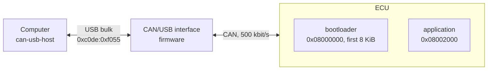

The CAN/USB interface is a USB adapter that connects a computer to a CAN
bus. The computer uses it to log the bus, and the manager app will use it to
flash ECUs over the [[bootloader|CAN bootloader protocol]].



The interface is not an ECU and has no CAN bootloader. It runs from the
start of flash and is flashed with a debug probe on the STDC14 connector.

# Hardware

The firmware runs on an STM32G431CB with a 16 MHz crystal. USB is on PA11
and PA12, and FDCAN1 is on PB8 and PB9. A TJA1042 transceiver connects
FDCAN1 to the bus. The KiCad project is in `ecus/can-usb/hardware`.

The interface has no bus termination. The ECUs at the ends of the bus
terminate it, so the interface can be plugged in anywhere along it.

## Option bytes {#option-bytes}

PB8 is also the STM32's BOOT0 pin, and on the G431 FDCAN1 has no other
pins: the only alternative, PA11 and PA12, is taken by USB. The transceiver
drives RXD high while the bus is idle. With the factory option bytes the MCU
reads that as BOOT0 high at reset and starts ST's ROM bootloader instead of
the firmware.

Set the option bytes once on each new board so the MCU ignores the pin and
always boots from flash:

| Option bit | Value | Effect |
| --- | --- | --- |
| `nSWBOOT0` | 0 | Take BOOT0 from the `nBOOT0` bit, not the pin |
| `nBOOT0` | 1 | Boot from main flash |

With a debug probe connected, STM32CubeProgrammer sets them:

```sh
STM32_Programmer_CLI -c port=SWD mode=UR -ob nSWBOOT0=0 nBOOT0=1
```

After this, the ROM bootloader starts only while main flash is blank.

# CAN side

The interface runs FDCAN1 as classic CAN at 500 kbit/s. Its filter accepts
every frame with a standard identifier. It reports bus errors to the
computer as they happen.

Two queues of four entries connect the CAN and USB tasks, one in each
direction. Both are priority queues. Bus errors leave first, then frames
with the lowest identifier, which is the order of CAN arbitration. When the
transmit mailbox is full, the embassy CAN driver drops the queued frame
with the lowest priority to make room. The firmware logs each dropped frame
over defmt.

# USB protocol {#usb-protocol}

The interface enumerates as USB device `0xc0de:0xf055` with one
vendor-specific interface. The computer sends on bulk OUT endpoint `0x01`
and receives on bulk IN endpoint `0x82`. Packets are at most 64 bytes.

Each transfer carries values encoded with
[postcard](https://postcard.jamesmunns.com/). The computer sends frames,
and the interface sends bus events. The types are defined in
[`crates/can-usb-protocol`](https://github.com/aphid-ev/aphid-ev/tree/main/crates/can-usb-protocol).

The firmware on the interface and the host library on the computer are
installed separately, so the encoding is a compatibility contract between
them. Tests in the crate pin the exact bytes.

## Frame

A frame is its identifier followed by a length-prefixed payload, so it
takes only as many bytes as it carries. All integers are varints.

| Field | Encoding |
| --- | --- |
| Identifier kind | `0` standard, `1` extended |
| Identifier | Varint |
| Payload length | Varint, 0 to 8 |
| Payload | The bytes |

The standard frame `0x123` with payload `01 02 03` encodes as
`00 a3 02 03 01 02 03`. A frame with an out-of-range identifier or more
than eight bytes fails to decode.

One transfer may hold several frames back to back, and the interface
decodes them all. The host library sends one frame per transfer.

## Bus event

A bus event is a tag followed by its contents. The interface sends one
event per transfer.

| Tag | Event | Contents |
| --- | --- | --- |
| 0 | Frame | A frame, encoded as above |
| 1 | Bus error | One byte: 0 stuff, 1 form, 2 acknowledge, 3 bit recessive, 4 bit dominant, 5 CRC, 6 software |

# Host access {#host-access}

- On Linux, install `ecus/can-usb/host/70-can-usb.rules` in
  `/etc/udev/rules.d/` to use the interface without root.
- On Windows, the interface sends Microsoft OS 2.0 descriptors, so Windows
  binds the WinUSB driver to it without a driver install.
- macOS needs no setup.

The `can-usb` command line tool in `ecus/can-usb/host` tests the interface:

| Command | What it does |
| --- | --- |
| `can-usb listen` | Prints every frame and bus error |
| `can-usb ping` | Sends a frame every 5 seconds and prints the next event |
| `can-usb throughput` | Sends 1000 frames, waits for an event after each, and prints the rate |

`ping` and `throughput` need another node on the bus to answer, such as an
ECU running the `can-echo` test application. They send on `0x7ff`, which is
also the bootloader's wakeup identifier.
