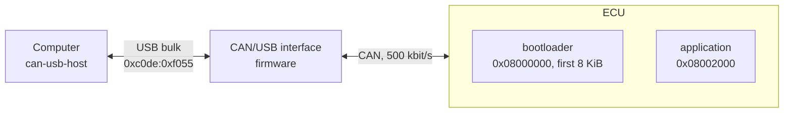

The CAN/USB interface is a USB adapter that connects a computer to a CAN
bus. The computer uses it to log the bus, and the manager app will use it to
flash ECUs over the [[bootloader|CAN bootloader protocol]].



The interface is not an ECU and has no CAN bootloader. It runs from the
start of flash and is flashed with a debug probe on the STDC14 connector.

# Hardware

The firmware runs on an STM32G431CB with a 16 MHz crystal. USB is on PA11
and PA12, and FDCAN1 is on PB8 and PB9. A TJA1042 transceiver connects
FDCAN1 to the bus. The KiCad project is in `ecus/can-usb/hardware`.

The interface has no bus termination. The ECUs at the ends of the bus
terminate it, so the interface can be plugged in anywhere along it.

## Option bytes {#option-bytes}

PB8 is also the STM32's BOOT0 pin, and on the G431 FDCAN1 has no other
pins: the only alternative, PA11 and PA12, is taken by USB. The transceiver
drives RXD high while the bus is idle. With the factory option bytes the MCU
reads that as BOOT0 high at reset and starts ST's ROM bootloader instead of
the firmware.

Set the option bytes once on each new board so the MCU ignores the pin and
always boots from flash:

| Option bit | Value | Effect |
| --- | --- | --- |
| `nSWBOOT0` | 0 | Take BOOT0 from the `nBOOT0` bit, not the pin |
| `nBOOT0` | 1 | Boot from main flash |

With a debug probe connected, STM32CubeProgrammer sets them:

```sh
STM32_Programmer_CLI -c port=SWD mode=UR -ob nSWBOOT0=0 nBOOT0=1
```

After this, the ROM bootloader starts only while main flash is blank.

# CAN side

The interface runs FDCAN1 as classic CAN at 500 kbit/s. Its filter accepts
every frame with a standard identifier. It reports bus errors to the
computer as they happen.

Two queues of four entries connect the CAN and USB tasks, one in each
direction. Received frames and bus errors go to the computer in the order
they happened. Frames from the computer pass through a priority queue that
sends the lowest identifier first, which is the order of CAN arbitration.
When the transmit mailbox is full, the embassy CAN driver drops the queued
frame with the lowest priority to make room. The firmware logs each dropped
frame over defmt.

# USB protocol {#usb-protocol}

The protocol is defined once, in
[`crates/can-usb-protocol`](https://github.com/aphid-ev/aphid-ev/tree/main/crates/can-usb-protocol):
the constants below, every type on the wire, and the packer and unpacker
that both ends use. The firmware on the interface and the host library on
the computer are installed separately, so the encoding is a compatibility
contract between them. Tests in the crate pin the exact bytes of every type.

| Constant | Value |
| --- | --- |
| Vendor and product ID | `0xc0de:0xf055` |
| Interface | `0`, vendor-specific (class `0xff`) |
| Bulk OUT, computer to interface | endpoint `0x01` |
| Bulk IN, interface to computer | endpoint `0x82` |
| Largest packet | 64 bytes |
| Protocol version | 1 |

The protocol version goes up with every change to an encoding or to what a
request means. The interface reports it in its device info, so a host can
refuse a device it would misread.

## Packets

Values are encoded with [postcard](https://postcard.jamesmunns.com/). A
bulk packet holds a whole number of values back to back, and no value is
split across two packets. Each packet decodes on its own. If a packet ends
in bytes that are not a whole value, the receiver keeps the values before
them and drops the rest of that packet. An empty packet carries nothing.

Bulk OUT carries frames to send on the bus. Bulk IN carries bus events.
The host library sends one frame per packet, and the interface sends one
event per packet.

Integers are varints unless the table says otherwise. Enums are encoded as
a varint tag, their position in the list, followed by their fields. A tag
the receiver does not know fails to decode, so a newer peer is never
misread as an older one.

## Frame

A frame is its identifier followed by a length-prefixed payload, so it
takes only as many bytes as it carries. Only classic CAN frames exist on
the wire, without a remote-frame flag.

| Field | Encoding |
| --- | --- |
| Identifier kind | `0` standard, `1` extended |
| Identifier | Varint, up to `0x7ff` or `0x1fffffff` |
| Payload length | Varint, 0 to 8 |
| Payload | The bytes |

The standard frame `0x123` with payload `01 02 03` encodes as
`00 a3 02 03 01 02 03`. A frame with an out-of-range identifier or more
than eight bytes fails to decode.

## Bus event

Every event starts with its tag and a timestamp. The timestamp is the
interface's clock in microseconds, as four little-endian bytes. It wraps
after 2³² µs, about 71.6 minutes, and the host unwraps it.

| Tag | Event | Fields after the timestamp |
| --- | --- | --- |
| 0 | Frame received | A frame, encoded as above |
| 1 | Bus error | One byte: 0 stuff, 1 form, 2 acknowledge, 3 bit recessive, 4 bit dominant, 5 CRC, 6 software |
| 2 | Bus state changed | State (0 error active, 1 error passive, 2 bus off), then the transmit and receive error counters, one byte each |
| 3 | Overrun | Number of received frames the interface could not forward, varint |

Examples, with the bytes grouped by field:

| Event | Bytes |
| --- | --- |
| Frame `0x123` `01 02 03` at 0x12345678 µs | `00` `78 56 34 12` `00 a3 02 03 01 02 03` |
| CRC error at 1 µs | `01` `01 00 00 00` `05` |
| Error passive, TEC 128, REC 7, at 0xffffffff µs | `02` `ff ff ff ff` `01` `80` `07` |
| 300 frames lost at 0 µs | `03` `00 00 00 00` `ac 02` |

The largest event, an extended frame with eight bytes, takes 20 bytes, so
three fit in a packet.

The firmware runs embassy's clock at 1 MHz, so timestamps resolve one
microsecond. The firmware stamps a received frame when it reads the frame
out of the FDCAN receive FIFO. The stamp lags the frame's arrival on the
bus by however long the frame waited in that FIFO. The embassy driver
tries to correct for the wait with the FDCAN timestamp counter, but it
converts the counter's bit times as time quanta, so the correction is
about a thousand times too small. A bus error is stamped when the
firmware reads it. The interface sends frames and bus
errors. The protocol defines bus state and overrun events, but the firmware
does not send them yet.

## Control requests {#control-requests}

Configuration and queries go over vendor control requests to interface 0.
Each request has request type vendor, recipient interface, `wValue` 0 and
`wIndex` 0. A payload is one postcard value. Request `0x01` is taken by the Microsoft OS
2.0 descriptors that Windows asks for.

| Request | Code | Direction | Payload |
| --- | --- | --- | --- |
| Get device info | `0x10` | Interface to computer | Device info |
| Set config | `0x11` | Computer to interface | Config |
| Start bus | `0x12` | Computer to interface | None |
| Stop bus | `0x13` | Computer to interface | None |

The device info is the protocol version, the firmware version as major,
minor and patch as varints, and the microcontroller's 96-bit unique ID as
twelve raw bytes. Protocol 1, firmware 0.2.300 and serial `00 01 … 0b`
encode as `01` `00 02 ac 02` `00 01 02 03 04 05 06 07 08 09 0a 0b`. The
protocol version comes first and stays first, so a host can read it from
any later version.

A config is a bit rate and a mode, one tag each:

| Tag | Bit rate | Mode |
| --- | --- | --- |
| 0 | 125 kbit/s | Normal |
| 1 | 250 kbit/s | Listen-only: never transmits or acknowledges |
| 2 | 500 kbit/s | Internal loopback: sent frames come back without reaching the bus |
| 3 | 1 Mbit/s | |

250 kbit/s in listen-only mode encodes as `01 01`. At power-on the
interface runs at 500 kbit/s in normal mode, so a host that never
configures it still works.

The current firmware does not answer these requests yet and always runs
with the power-on config.

# Host access {#host-access}

- On Linux, install `ecus/can-usb/host/70-can-usb.rules` in
  `/etc/udev/rules.d/` to use the interface without root.
- On Windows, the interface sends Microsoft OS 2.0 descriptors, so Windows
  binds the WinUSB driver to it without a driver install.
- macOS needs no setup.

The `can-usb` command line tool in `ecus/can-usb/host` tests the interface:

| Command | What it does |
| --- | --- |
| `can-usb listen` | Prints every frame and bus error with its timestamp |
| `can-usb ping` | Sends a frame every 5 seconds and prints the next event |
| `can-usb throughput` | Sends 1000 frames, waits for an event after each, and prints the rate |

`ping` and `throughput` need another node on the bus to answer, such as an
ECU running the `can-echo` test application. They send on `0x7ff`, which is
also the bootloader's wakeup identifier.
