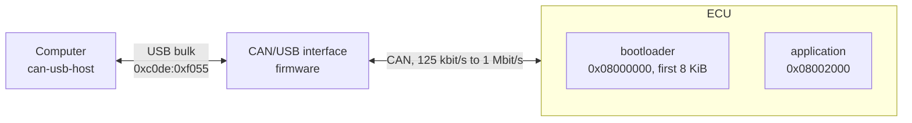

The CAN/USB interface is a USB adapter that connects a computer to a CAN
bus. The computer uses it to log the bus, and the manager app will use it to
flash ECUs over the [[bootloader|CAN bootloader protocol]].



The interface is not an ECU and has no CAN bootloader. It runs from the
start of flash and is flashed with a debug probe on the STDC14 connector.

# Hardware

The board is an STM32G431CB with a 16 MHz crystal and a TJA1042
transceiver between FDCAN1 and the bus. The KiCad project is in
`ecus/can-usb/hardware`. The firmware supports revision A of the board,
tagged `can-usb-hw-revA`, and no other. The firmware names its pins in
`firmware/src/board.rs` and nowhere else:

| Signal | Pin | Function |
| --- | --- | --- |
| USB D− and D+ | PA11, PA12 | |
| FDCAN1 RX and TX | PB8, PB9 | To the transceiver |
| `CAN_STB` | PC13 | Transceiver standby, high is standby |
| `LED_RX` | PA7 | RX LED, high is on |
| `LED_TX` | PA6 | TX LED, high is on |
| `LED_ERR` | PA5 | ERR LED, high is on |
| HSE | PF0, PF1 | 16 MHz crystal |

A pull-up holds the transceiver's STB input high, so after reset the
transceiver is in standby. In standby it does not drive the bus and does not
pass received bits on. The firmware drives STB low once FDCAN1 is set up,
just before FDCAN1 starts, and it drives STB high again whenever the bus is
stopped. In internal loopback mode STB stays high the whole time.

The interface has four LEDs:

| LED | Colour | Lit while |
| --- | --- | --- |
| Power | | The 3.3 V rail is up. Not under firmware control |
| RX | Green | For 20 ms after each received frame |
| TX | Green | For 20 ms after each frame handed to the transmit mailbox |
| ERR | Red | While the controller is error passive or bus-off, and for 500 ms after each bus error |

Each new frame or error restarts the time of its LED, so RX and TX stay lit
on a busy bus. When the controller is error active again, ERR goes out
500 ms later.

The interface has no bus termination. The ECUs at the ends of the bus
terminate it, so the interface can be plugged in anywhere along it.

## Option bytes {#option-bytes}

PB8 is also the STM32's BOOT0 pin, and on the G431 FDCAN1 has no other
pins: the only alternative, PA11 and PA12, is taken by USB. The transceiver
drives RXD high while the bus is idle. With the factory option bytes the MCU
reads that as BOOT0 high at reset and starts ST's ROM bootloader instead of
the firmware.

Set the option bytes once on each new board so the MCU ignores the pin and
always boots from flash:

| Option bit | Value | Effect |
| --- | --- | --- |
| `nSWBOOT0` | 0 | Take BOOT0 from the `nBOOT0` bit, not the pin |
| `nBOOT0` | 1 | Boot from main flash |

With a debug probe connected, STM32CubeProgrammer sets them:

```sh
STM32_Programmer_CLI -c port=SWD mode=UR -ob nSWBOOT0=0 nBOOT0=1
```

After this, the ROM bootloader starts only while main flash is blank.

# CAN side

The interface runs FDCAN1 as classic CAN at 125, 250 or 500 kbit/s or
1 Mbit/s. The computer sets the bit rate and the mode with the
[control requests](#control-requests). The interface starts at 500 kbit/s
in normal mode. Its filters pass every standard and every extended identifier. The controller rejects remote
frames, so the interface does not forward them. The protocol's `Frame` has
no remote flag. The interface reports bus errors to the
computer as they happen.

Two FIFO queues connect the CAN and USB tasks, one in each direction, so
nothing is reordered. Received frames and bus errors reach the computer in
the order they happened, and frames from the computer go on the bus in the
order it sent them.

The receive queue holds 128 events. That is 28 ms of a saturated bus of
8-byte frames, or 13 ms of empty ones. The receive task never waits for
room in it, because FDCAN1's own receive FIFO holds only three frames and
would overflow while it waited. The receive task counts each frame that
does not fit instead. As soon as there is room again, the interface sends
one overrun event with the count, in the place where the frames went
missing, and starts counting from zero. If the computer stops reading for a
while, the first event it gets after it resumes is that overrun. A bus
error that finds the queue full is logged over defmt and not reported to
the computer.

Until the computer's USB stack configures the device, the firmware
discards events at the USB end, so they are neither queued nor counted.
It logs this once over defmt when it starts discarding, and once with
the number of events discarded when the computer takes packets again.
Linux, Windows and macOS configure the device when it is plugged in,
whether or not a program opens it. From then on the queue fills while no
program reads. Start bus and set config clear it, together with the
overrun count, and the host library sends start bus when it opens the
interface. A program that opens it later starts with an empty queue, except
for at most one packet of up to three old events that the firmware had
already handed to the USB controller.

## Bus state and bus-off {#bus-state}

While the bus runs, the firmware reads FDCAN1's fault confinement state,
its error counters and its last error code every 10 ms. It sends a bus
state event each time the state changes between error active, error
passive and bus-off, and one right after each start of the bus, so the
computer always knows the current state. A change of the counters alone
sends nothing. In listen-only mode the controller never transmits, so only
the receive counter rises: it can turn error passive but never goes
bus-off.

A state event that finds the queue full is sent again 10 ms later, with the
counters of that moment, until it fits. If the state changed in the
meantime, only the latest one is sent. State events go through the same
overrun counting as frames, so one never lands ahead of an overrun that
happened before it.

The embassy driver would take FDCAN1 out of bus-off at once. The firmware
turns that off. 100 ms after the firmware first sees
bus-off, it takes the controller out of init with its configuration
unchanged. The controller then waits for 128 sequences of 11 recessive
bits, about 2.8 ms at 500 kbit/s, and becomes error active, which sends the
next state event. If it is still bus-off 100 ms after a recovery started,
the firmware starts another. A shorted bus therefore goes bus-off and
recovers over and over. Each round sends one or two state events. If a
status read sees the controller error active between two recoveries, the
round sends that error-active event and the next bus-off event. If none
does, the controller is stuck in bus-off or went back to it within 10 ms,
and the next recovery sends one bus-off event with the counters of that
moment.
A stop, start or set config request while the firmware waits ends the
wait, and the bus starts again or stays stopped as the request says. The
recovery does not clear the queues, so events already queued for the
computer stay queued.

The controller keeps its last error code until it is read, and reading
clears it. Two places in the firmware read it: the status read every
10 ms, and the embassy driver's receive path, which reads it whenever its
receive FIFO is empty. Each error therefore reaches the computer once,
from whichever read saw it first. During the recovery the controller
reports a bit error for every 11 recessive bits it counts. The firmware
drops every error from either read while the last status showed bus-off,
until a status shows the controller back on the bus. The error that caused
the bus-off is still sent, because it comes before the first status that
shows bus-off.

The firmware does not see FDCAN1's own receive FIFO overflow, because
embassy-stm32 0.6 does not expose the controller's message-lost flag.
Frames lost there are not counted.

The transmit queue holds 64 frames, three full USB packets of the shortest
frames. FDCAN1's three transmit buffers work as a FIFO too, and no queued
frame is ever dropped to make room. When the buffers and the queue are
full, the interface stops reading the bulk OUT endpoint, and the endpoint
answers the computer's next packets with NAK until there is room. On a bus where no other node acknowledges, the
controller retries the frame without end, so a send from the computer can
wait until the computer stops the bus or changes its config.

While the bus is stopped, and in listen-only mode, the interface takes
frames from the computer and discards them, so the bulk OUT endpoint never
NAKs. It counts them and logs the count over defmt when the bus starts
again or the mode changes. It does not report them to the computer as
lost.

## Bit timing

FDCAN1 runs from a 48 MHz clock. The firmware lets embassy compute the bit
timing, which samples every rate at 87.5 % with a resynchronisation jump
width of one time quantum:

| Bit rate | Prescaler | Time quanta per bit | Segment 1 | Segment 2 |
| --- | --- | --- | --- | --- |
| 125 kbit/s | 24 | 16 | 13 | 2 |
| 250 kbit/s | 12 | 16 | 13 | 2 |
| 500 kbit/s | 6 | 16 | 13 | 2 |
| 1 Mbit/s | 6 | 8 | 6 | 1 |

## Starting and stopping

embassy-stm32 cannot take a running FDCAN1 back to configuration mode. To
stop the bus, the firmware puts the transceiver in standby and drops the
controller, which turns its clock off and disconnects its pins. To start
it, the firmware resets FDCAN1 and configures it again from scratch. One
task owns FDCAN1 and does both. The USB side only sends it commands.

Every stop and every restart discards the frames waiting to be sent: those
in the transmit queue, the one being written, and up to three in FDCAN1's
transmit buffers. A frame queued for one bit rate never goes out at
another. Only the frames in the transmit buffers are not counted.

Per-frame log lines over defmt are at `trace` level. The firmware builds
with `DEFMT_LOG=info` by default, so they are not compiled in.

# USB protocol {#usb-protocol}

The protocol is defined once, in
[`crates/can-usb-protocol`](https://github.com/aphid-ev/aphid-ev/tree/main/crates/can-usb-protocol):
the constants below, every type on the wire, and the packer and unpacker
that both ends use. The firmware on the interface and the host library on
the computer are installed separately, so the encoding is a compatibility
contract between them. Tests in the crate pin the exact bytes of every type.

| Constant | Value |
| --- | --- |
| Vendor and product ID | `0xc0de:0xf055` |
| Interface | `0`, vendor-specific (class `0xff`) |
| Bulk OUT, computer to interface | endpoint `0x01` |
| Bulk IN, interface to computer | endpoint `0x82` |
| Largest packet | 64 bytes |
| Protocol version | 1 |

The protocol version goes up with every change to an encoding or to what a
request means. The interface reports it in its device info, so a host can
refuse a device it would misread.

## Packets

Values are encoded with [postcard](https://postcard.jamesmunns.com/). A
bulk packet holds a whole number of values back to back, and no value is
split across two packets. Each packet decodes on its own. If a packet ends
in bytes that are not a whole value, the receiver keeps the values before
them and drops the rest of that packet. An empty packet carries nothing.

Bulk OUT carries frames to send on the bus. Bulk IN carries bus events.
The host library sends one frame per packet.

The interface packs as many events into each IN packet as it has queued.
It waits for one event, adds every other event already in the receive
queue until the next one does not fit, and sends the packet. The event
that did not fit opens the next packet. There is no timer, so on a quiet
bus each event goes out on its own as soon as it happens, and in a burst
the packets fill up.

The IN endpoint has one packet buffer. The firmware hands a packet to the
USB driver once the computer has collected the one before it, and then
builds the next packet at once. That next packet then waits until the
computer collects the one in the buffer, and events that arrive in the
meantime go into the packet after it. A packet in the buffer that the
computer never collects, because of a USB reset or an unplug, is lost, and
the interface does not count it.

An IN packet is at most 63 bytes, one short of the largest packet. A USB
bulk transfer ends with a packet shorter than the largest, so every IN
packet ends its transfer and the interface never needs to send a
zero-length packet. A host read returns exactly one packet as soon as the
interface sends it, whatever the size of the buffer. A 64-byte buffer is
enough. To keep the endpoint busy, a host keeps several such reads
outstanding instead of one large one. The crate defines the limit as
`BULK_IN_PACKET_LIMIT`.

Integers are varints unless the table says otherwise. Enums are encoded as
a varint tag, their position in the list, followed by their fields. A tag
the receiver does not know fails to decode, so a newer peer is never
misread as an older one.

## Frame

A frame is its identifier followed by a length-prefixed payload, so it
takes only as many bytes as it carries. Only classic CAN frames exist on
the wire, without a remote-frame flag.

| Field | Encoding |
| --- | --- |
| Identifier kind | `0` standard, `1` extended |
| Identifier | Varint, up to `0x7ff` or `0x1fffffff` |
| Payload length | Varint, 0 to 8 |
| Payload | The bytes |

The standard frame `0x123` with payload `01 02 03` encodes as
`00 a3 02 03 01 02 03`. A frame with an out-of-range identifier or more
than eight bytes fails to decode.

## Bus event

Every event starts with its tag and a timestamp. The timestamp is the
interface's clock in microseconds, as four little-endian bytes. It wraps
after 2³² µs, about 71.6 minutes, and the host unwraps it.

| Tag | Event | Fields after the timestamp |
| --- | --- | --- |
| 0 | Frame received | A frame, encoded as above |
| 1 | Bus error | One byte: 0 stuff, 1 form, 2 acknowledge, 3 bit recessive, 4 bit dominant, 5 CRC, 6 software |
| 2 | Bus state changed | State (0 error active, 1 error passive, 2 bus off), then the transmit and receive error counters, one byte each |
| 3 | Overrun | Number of received frames the interface could not forward, varint |

Examples, with the bytes grouped by field:

| Event | Bytes |
| --- | --- |
| Frame `0x123` `01 02 03` at 0x12345678 µs | `00` `78 56 34 12` `00 a3 02 03 01 02 03` |
| CRC error at 1 µs | `01` `01 00 00 00` `05` |
| Error passive, TEC 128, REC 7, at 0xffffffff µs | `02` `ff ff ff ff` `01` `80` `07` |
| 300 frames lost at 0 µs | `03` `00 00 00 00` `ac 02` |

The largest event, an extended frame with eight bytes, takes 20 bytes, so
three fit in a packet.

The firmware runs embassy's clock at 1 MHz, so timestamps resolve one
microsecond. The firmware stamps a received frame when it reads the frame
out of the FDCAN receive FIFO. The stamp lags the frame's arrival on the
bus by however long the frame waited in that FIFO. The embassy driver
tries to correct for the wait with the FDCAN timestamp counter, but it
converts the counter's bit times as time quanta, so the correction is
about a thousand times too small. A bus error or a bus state is stamped
when the firmware reads it, and an overrun carries the stamp of the first
frame it counts. See [bus state and bus-off](#bus-state) for when the
interface sends a state event.

## Control requests {#control-requests}

Configuration and queries go over vendor control requests to interface 0.
Each request has request type vendor, recipient interface, `wValue` 0 and
`wIndex` 0. A payload is one postcard value. Request `0x01` is taken by the Microsoft OS
2.0 descriptors that Windows asks for.

| Request | Code | Direction | Payload |
| --- | --- | --- | --- |
| Get device info | `0x10` | Interface to computer | Device info |
| Set config | `0x11` | Computer to interface | Config |
| Start bus | `0x12` | Computer to interface | None |
| Stop bus | `0x13` | Computer to interface | None |

What each request does depends on whether the bus runs:

| Request | Bus running | Bus stopped |
| --- | --- | --- |
| Get device info | Answers | Answers |
| Set config | Restarts the bus with the new config and clears the receive queue | Stores the config for the next start and clears the receive queue |
| Start bus | Restarts the bus and clears the receive queue | Starts the bus with the stored config and clears the receive queue |
| Stop bus | Stops the bus. The receive queue is kept | Nothing |

Each start, restart and stop also discards the frames waiting to be sent.
While the bus is stopped the transceiver is in standby.

The interface STALLs a request it does not know, a request in the wrong
direction, a `wValue` other than 0, start or stop with data, and a config
that does not decode or has bytes after it. A rejected request changes
nothing.

The device info is the protocol version, the firmware version as major,
minor and patch as varints, and the microcontroller's 96-bit unique ID as
twelve raw bytes. Protocol 1, firmware 0.2.300 and serial `00 01 … 0b`
encode as `01` `00 02 ac 02` `00 01 02 03 04 05 06 07 08 09 0a 0b`. The
protocol version comes first and stays first, so a host can read it from
any later version.

A config is a bit rate and a mode, one tag each:

| Tag | Bit rate | Mode |
| --- | --- | --- |
| 0 | 125 kbit/s | Normal |
| 1 | 250 kbit/s | Listen-only: never transmits or acknowledges |
| 2 | 500 kbit/s | Internal loopback: sent frames come back without reaching the bus |
| 3 | 1 Mbit/s | |

250 kbit/s in listen-only mode encodes as `01 01`. At power-on the
interface runs at 500 kbit/s in normal mode, so a host that never
configures it still works. After a USB reset it goes back to that, running.
A stopped bus stays stopped when the program that stopped it exits, until
another program starts it or the computer resets the USB device.

In listen-only mode FDCAN1 runs in bus monitoring mode. It receives every
frame on the bus but never drives a dominant bit, so it neither transmits
nor acknowledges.

# Host access {#host-access}

- On Linux, install `ecus/can-usb/host/70-can-usb.rules` in
  `/etc/udev/rules.d/` to use the interface without root.
- On Windows, the interface sends Microsoft OS 2.0 descriptors, so Windows
  binds the WinUSB driver to it without a driver install.
- macOS needs no setup.

The host library in `ecus/can-usb/host` reads the device info when it
opens the interface and refuses one with another protocol version. Then it
sends start bus, so the program begins with an empty receive queue. It has
calls for each request: `device_info()`, `set_config()`, `start()` and
`stop()`.

The `can-usb` command line tool in `ecus/can-usb/host` tests the interface:

| Command | What it does |
| --- | --- |
| `can-usb info` | Prints the protocol version, the firmware version and the serial number |
| `can-usb listen` | Prints every frame and bus error with its timestamp |
| `can-usb ping` | Sends a frame every 5 seconds and prints the next event |
| `can-usb throughput` | Sends 1000 frames, waits for an event after each, and prints the rate |

Every command except `info` first sets the config from two options:

| Option | Values | Default |
| --- | --- | --- |
| `--bitrate`, `-b` | `125`, `250`, `500` or `1000`, in kbit/s | `500` |
| `--mode`, `-m` | `normal`, `listen-only` or `loopback` | `normal` |

`ping` and `throughput` need another node on the bus to answer, such as an
ECU running the `can-echo` test application. With `--mode loopback` the
interface answers itself. They send on `0x7cf`, which is
kept free for bus tests just below the identifiers of the
[[bootloader|CAN bootloader]]. It is `BUS_TEST_ID` in `crates/boot-protocol`.
