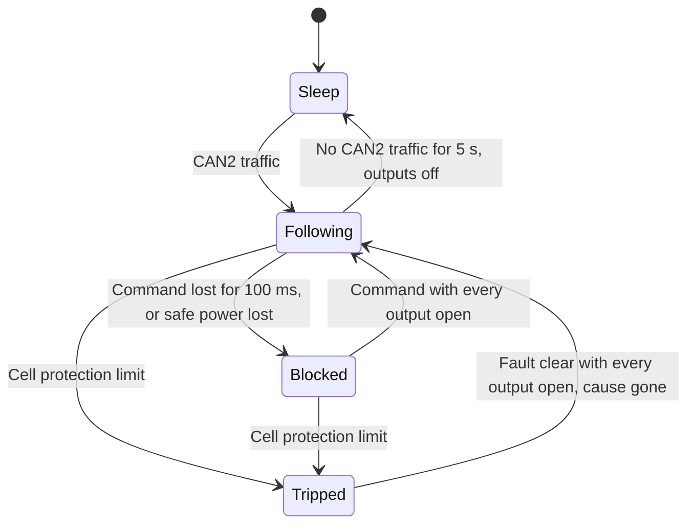
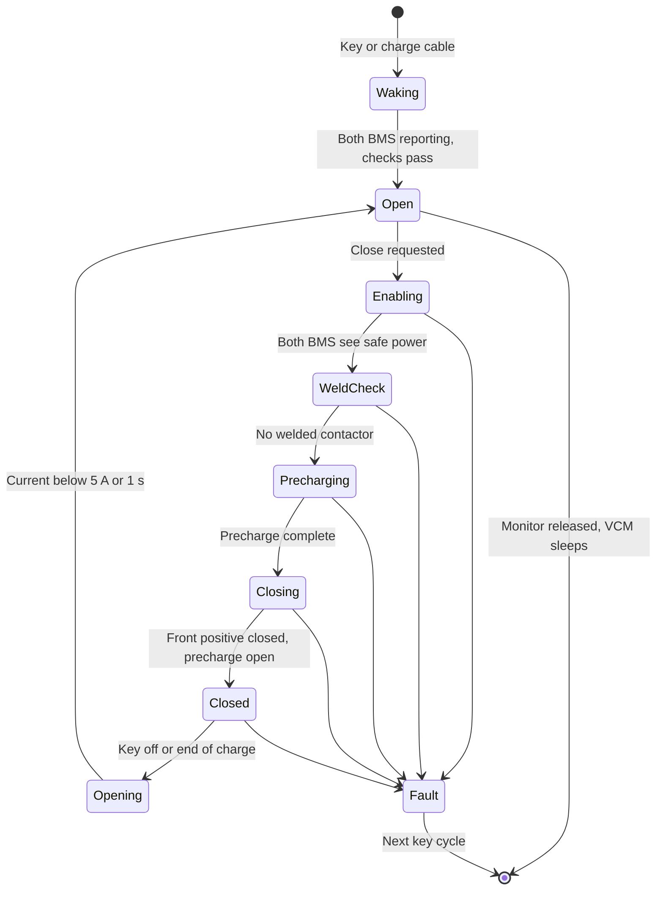
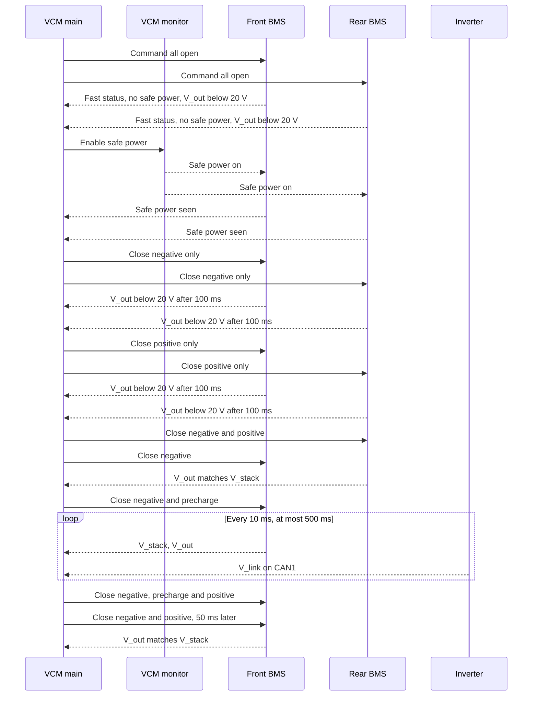
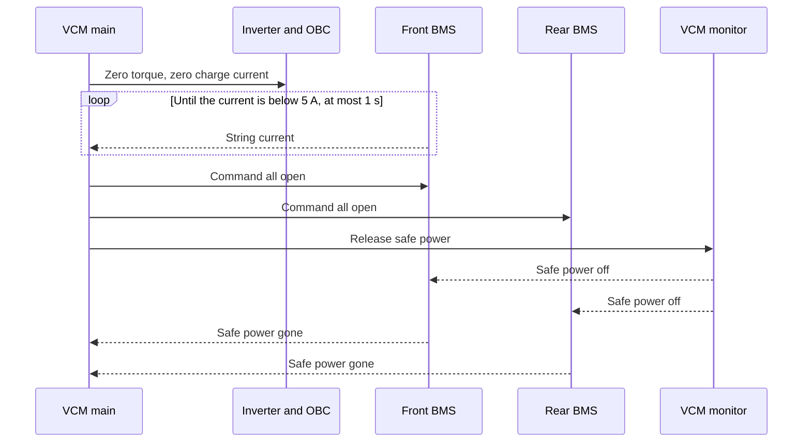

The main contactors keep the HV system de-energised whenever the car is not
in use. They are part of the [[safety]] concept and the last resort for
bringing the system into a safe state.

This page specifies how the contactors are closed and opened, and what each
unit does in between. The [[safety#fault-reactions|fault reactions]] are on
the safety page.

# Main contactors

Each of the [[batteries]] has a positive and a negative main contactor, all
[Littelfuse DCNHE250MFA-B](https://www.littelfuse.com/products/relays-contactors-transformers/high-voltage-dc-contactor-relays/dcnhe250/dcnhe250mfa-b)
units. The string runs from the pack negative through the MSD, the front
negative contactor, the front cell stack, the front positive contactor, the
series link, the rear negative contactor, the rear cell stack and the rear
positive contactor to the pack positive.

The contactors have mechanically linked auxiliary contacts. They are not
wired. Welded contactors are found from the BMS voltage measurements
instead, so any contactor can be used, with or without auxiliary contacts.

# Precharge

Precharge is a Littelfuse `DCNSEV30-B` in series with a `10 Ω 100 W` power
resistor, connected in parallel with the positive main contactor in the
[[batteries#front-battery|front battery]].

The DC-link capacitance of the inverter and the OBC/DC-DC is not known yet.
It will be measured. The precharge timeouts below are provisional until
then.

# Who does what {#roles}

Every contactor coil has two switches in series. Both have to be on for the
contactor to close.

| Unit | Switches | Decides |
| --- | --- | --- |
| VCM main processor | Nothing directly | Everything: when to close and open, precharge, welded-contactor checks and the reaction to faults. |
| VCM monitor processor | The high-side supply to every coil, called safe power | Only when to cut safe power, as described under [[Monitor firmware]]. |
| Front and rear BMS | The low side of each coil in its pack | Nothing about the sequence. It drives its outputs as the VCM commands, and opens them on its own only for the reasons under [[#bms-rules]]. |

The BMS is responsible for its cells. It estimates the state of charge,
reports the current the pack can take in and give out, and acts when a cell
or the current goes outside its limits. See
[[safety#cell-protection|cell protection]].

The VCM main processor also reads the [[safety#interlock|HV interlock loop]]
on its own input, so it can react to an open loop without waiting for the
monitor.

# Voltage measurements {#measurements}

Each BMS measures two voltages in its pack and reports both on CAN2:

- `V_stack`, across the cell stack, inside the contactors. The BMS checks
  it against the sum of its cell voltages.
- `V_out`, across the pack's two HV terminals, outside both main
  contactors. With either contactor open, the sense divider pulls it to
  about 0 V.

The front BMS also measures the string current on the shunt. The rear BMS
has no shunt and takes the current from the front BMS's CAN2 message.

The [[inverter]] reports the DC-link voltage `V_link` on CAN1. Once the
contactors are closed, `V_link` equals `V_out` of the front pack plus `V_out`
of the rear pack.

# CAN2 traffic {#can2}

The [[EV-CAN#vehicle-buses|CAN2]] message crate defines the frames. This
page sets what they carry and how often.

| Message | From | Period | Content |
| --- | --- | --- | --- |
| Contactor command | VCM, one per BMS | 10 ms | One bit per output: negative, positive and, for the front BMS, precharge. A fault clear bit. Alive counter and CRC. |
| Fast status | Each BMS | 10 ms | Output states, safe power seen, `V_stack`, `V_out`, string current from the front BMS, open request and trip reason. Alive counter and CRC. |
| Pack status | Each BMS | 100 ms | State of charge, allowed charge and discharge current, minimum and maximum cell voltage and temperature. |

A receiver treats a frame with a wrong CRC, or with the same alive counter
as the previous frame, as missing. Both directions time out after
**100 ms**, which is ten missed frames.

# BMS rules {#bms-rules}

The BMS follows the contactor command, with four exceptions:

1. **Command lost.** No valid command for 100 ms. The BMS opens all its
   outputs and blocks.
2. **Safe power lost.** Safe power drops while an output is on. The BMS
   switches all its outputs off and blocks. A coil without its high side
   has already released, but switching the low side off keeps the contactor
   from closing again when safe power returns.
3. **Cell protection.** The BMS opens its outputs and trips on the limits
   under [[safety#cell-protection]].
4. **Blocked.** A blocked BMS ignores close bits until it has received a
   command with every output open. It then follows the command again. This
   keeps a contactor from closing without precharge when the bus or safe
   power comes back.

Safe power present with no output commanded on is normal between the
monitor enabling safe power and the first close command, and after a
controlled open. The BMS only reports it. The VCM uses that report to check
the high-side switch.

A BMS wakes on CAN2 traffic. It goes back to sleep when it has had no CAN2
traffic for **5 s** and all its outputs are off. It may stay awake longer to
finish cell balancing.

`Following` drives the outputs as commanded. `Blocked` and `Tripped` hold
every output off.

# VCM contactor states {#states}

The VCM main processor runs the sequence. Every step has a timeout, and
every timeout or failed check goes to `Fault`.

## Waking

The VCM starts sending contactor commands with every output open as soon as
it wakes. That traffic wakes both BMS controllers. Both have to send valid
fast status within **500 ms**. Then the VCM checks:

- Neither BMS reports a trip or an open request.
- Neither BMS sees safe power. Safe power present before the monitor has
  enabled it means a stuck high-side switch, which the monitor could not
  cut.
- `V_out` is below **20 V** on both packs. A higher voltage with every
  contactor open means both contactors of that pack have welded.
- `V_stack` of each pack agrees with the sum of its cells within **2 %**.

## Closing

The car closes the contactors the same way for driving and for charging.
Each step waits for the measurements to settle before it checks them.

1. **Enable safe power.** The VCM asks the monitor to enable safe power.
   Both BMS have to report safe power within **100 ms**.
2. **Check the positive contactors.** The VCM closes the negative contactor
   of both packs alone. After **100 ms**, `V_out` of each pack has to be
   below 20 V. A higher voltage means that pack's positive contactor has
   welded. On the front pack it can also be the precharge contactor. The
   VCM then opens both.
3. **Check the negative contactors.** The VCM closes the positive contactor
   of both packs alone, with the same check after 100 ms. A voltage now
   means the negative contactor has welded. The VCM then opens both.
   Both packs are checked at the same time. With one contactor of each pack
   closed there is still no closed circuit, so the sense dividers hold
   `V_out` near 0 V unless a contactor has welded.
4. **Close everything but the front positive.** The VCM closes the rear
   negative, the rear positive and the front negative. After **50 ms**,
   `V_out` of the rear pack has to be within **5 V** of its `V_stack`.
5. **Precharge.** The VCM closes the precharge contactor. Current flows
   through the resistor into the DC link, and `V_out` of the front pack
   rises toward its `V_stack`.
6. **Close the front positive.** The VCM closes it, waits **50 ms**, opens
   the precharge contactor and waits another 50 ms. `V_out` of the front
   pack then has to be within 5 V of its `V_stack`.

Precharge is complete when both hold:

- `V_stack` minus `V_out` of the front pack is below **10 V**, which means
  less than 1 A through the 10 Ω resistor.
- `V_link` from the inverter is within **15 V** of the front and rear
  `V_out` added together.

Precharge has failed when either holds:

- `V_out` of the front pack is below **50 %** of its `V_stack` 100 ms after
  the precharge contactor closed. A short on the HV bus puts about 40 A,
  or 16 kW, into the resistor, so this check cuts it short.
- Precharge is not complete within **500 ms**.

After a failed precharge the VCM opens everything. It tries again after
**30 s**, at most twice. A third failure latches `Fault` until the next key
cycle.

## Opening

A controlled open is used for key off, the end of a charge and the faults
the [[safety#fault-reactions|fault table]] marks as controlled.

1. The VCM commands zero torque from the inverter and zero current from the
   OBC.
2. It waits until the string current is below **5 A**, or at most **1 s**.
3. It commands every output open on both BMS in the same frame.
4. For a key off or the end of a charge, it asks the monitor to release safe
   power. Both BMS have to report safe power gone within **100 ms**.
   Otherwise the high-side switch is stuck on, which is a fault.

An immediate open skips step 2. The VCM commands every output open in the
next frame, whatever the current.

The weld checks run only while closing. After an open, the DC link stays
charged until the inverter discharges it, and both `V_out` dividers sit in
series across it, so `V_out` is not 0 V.

# Measurement disagreement {#disagreement}

While the contactors are closed, the VCM compares `V_link` with the front
and rear `V_out` added together. A difference above **20 V** for **1 s**
means one of the measurements is wrong. The VCM records a fault and keeps
the contactors closed, so the car does not lose drive. It refuses the next
close until the fault is cleared on a key cycle.

During precharge the same comparison, with the 15 V limit, is part of the
completion check. A disagreement there keeps the front positive open and
ends as a failed precharge.

# Drawings

The [[batteries#wiring|battery schematics]] show the contactors, their coil
wiring and the voltage sense leads. The
[[safety#interlock|interlock and safe power schematic]] shows the coil
supply from the VCM.
